# Energy AI: from power flow to reinforcement learning

A hands-on path through **AI for intelligent and integrated energy systems**, in 18 executed Jupyter notebooks (00–17). It
starts with a power flow on a four-house feeder and ends with physics-informed neural networks, learned control
policies, cyber attacks on state estimation and multi-energy hubs.

Every notebook uses **open real-world data** (European load, generation, prices and weather) or **standard benchmark
grids** (SimBench, IEEE 14-bus), checks its machine-learning results against physics simulations, and states plainly
when a simple method wins.

The topics follow the syllabus of the TU Delft / edX course *Digitalization of Intelligent and Integrated Energy
Systems* (DelftX IIES02x). This repository is an independent study project: it is not affiliated with TU Delft or
edX and contains no course material.

## Learning path

| # | Notebook | Level | Methods | Course module | Headline result |
|---|---|---|---|---|---|
| 00 | [check_device](notebooks/00_check_device.ipynb) | setup | PyTorch on CPU / CUDA / Intel XPU | – | 4096² matrix product 9.5× faster on an Intel Iris Xe iGPU |
| 01 | [power_flow_basics](notebooks/01_power_flow_basics.ipynb) | 1 · simulation | AC power flow (pandapower), SimBench, time series | M2 | a 4-house feeder hits its voltage limit at ≈ 80 kW, its thermal limit at ≈ 89 kW; PV back-feed causes the highest loading |
| 02 | [numerical_simulation_methods](notebooks/02_numerical_simulation_methods.ipynb) | 1 · simulation | Euler / RK4 / implicit ODE solvers, stiffness, Newton–Raphson vs Gauss–Seidel, AC vs DC, co-simulation | M2 | stiff frequency dynamics: RK45 needs 3 025 steps, BDF 169 |
| 03 | [load_profile_clustering_kmeans](notebooks/03_load_profile_clustering_kmeans.ipynb) | 2 · descriptive | k-means, silhouette, profile features | M4 | shops & services use 33 % of the energy but cause 50 % of the system peak |
| 04 | [anomaly_detection_autoencoder](notebooks/04_anomaly_detection_autoencoder.ipynb) | 2 · descriptive | autoencoder (GPU), PCA, isolation forest | M4 / M5 | autoencoder flags 87 % of false-data injections at 1.5 % false alarms (AUC 0.94 vs 0.74) |
| 05 | [forecasting_regression](notebooks/05_forecasting_regression.ipynb) | 3 · predictive | linear / polynomial regression, data cleaning, holidays | M4 | load MAPE 6.1 % → 5.0 %, solar nRMSE 9.7 % → 6.2 % |
| 06 | [forecasting_ensembles_neural](notebooks/06_forecasting_ensembles_neural.ipynb) | 3 · predictive | trees, random forest, boosting, SVR, MLP, stacking, meta-NN, quantile regression | M4 | day-ahead load MAPE 3.45 %; meta-network ensemble as used by National Grid ESO |
| 07 | [dynamic_security_assessment](notebooks/07_dynamic_security_assessment.ipynb) | 3 · predictive | frequency dynamics, decision trees, cost-sensitive classification | M4 | the tree rediscovers the RoCoF limit E_kin ≥ 50·P_loss; zero missed alarms at threshold 0.1 |
| 08 | [cable_overload_prediction](notebooks/08_cable_overload_prediction.ipynb) | 3 · **capstone** | logistic regression, trees, boosting, MLP, permutation importance | M4 final exercise | smart meters predict cable overloads (F1 0.92) without topology; the model finds the meters behind the cable |
| 09 | [optimal_scheduling_milp](notebooks/09_optimal_scheduling_milp.ipynb) | 4 · prescriptive | LP dispatch, MILP unit commitment, storage, Pareto front (Pyomo + HiGHS) | M3 | a battery saves 6 % but raises CO₂; abatement cost rises from 21 to 55 €/t |
| 10 | [surrogate_power_flow](notebooks/10_surrogate_power_flow.ipynb) | 4 · simulation + ML | neural surrogate (GPU), linear surrogate, extrapolation test | M4 | a full year of power flows in 0.3 s (×3 000) with overload hours within ±2 h, but errors up to 54 V once PV ×4 reverses the flows |
| 11 | [mpc_home_energy](notebooks/11_mpc_home_energy.ipynb) | 4 · decision under uncertainty | model predictive control, stochastic and robust MPC (LP) | M3 | two-layer MPC beats a battery rule by 11 %; naive stochastic and robust MPC do not help |
| 12 | [imitation_vs_reinforcement_learning](notebooks/12_imitation_vs_reinforcement_learning.ipynb) | 5 · learning control | behaviour cloning, DAgger, Q-learning, DQN, safety shield (Gymnasium) | M4 | imitation recovers 98 % of the MPC expert's saving; RL after 14 simulated years only 63–69 %, below a one-line rule |
| 13 | [physics_informed_power_flow](notebooks/13_physics_informed_power_flow.ipynb) | 5 · physics + ML | PINN with ΔP/ΔQ and Z-bus voltage residuals, loss conditioning | M4 | with zero labels the PINN matches a network trained on 1 000 power flows; the textbook ΔP/ΔQ loss (condition number ≈ 18 600) fails |
| 14 | [cybersecurity_state_estimation](notebooks/14_cybersecurity_state_estimation.ipynb) | 5 · security | WLS state estimation, χ² bad-data detection, stealthy FDI, ML detectors | M5 | χ² test is blind to stealthy attacks; boosting catches 83 % at 0.8 % false alarms |
| 15 | [congestion_management_flexibility](notebooks/15_congestion_management_flexibility.ipynb) | 6 · integration | EV smart charging LP, radial PTDF, AC validation | M6 | grid-blind smart charging overloads the cable to 337 %; grid-aware charging fixes all limits for +1 % cost |
| 16 | [digital_twin_building](notebooks/16_digital_twin_building.ipynb) | 6 · integration | grey-box calibration, Kalman filter, innovation-based fault detection | M1 | twin + Kalman filter tracks indoor temperature to 0.11 K and spots a COP fault within a day |
| 17 | [integrated_energy_hub](notebooks/17_integrated_energy_hub.ipynb) | 6 · integration | energy hub LP: heat pump, CHP, boiler, heat storage | integrated systems | in a cold, windless week a gas boiler is cleaner than a heat pump; timing matters |

Course modules: M1 digital twins · M2 numerical simulation · M3 decision support · M4 machine learning ·
M5 cybersecurity · M6 grid congestion management.

## How every model is validated

Each model is fitted on one part of the data and then **predicts a separate part it has never seen**; every score in the
notebooks and in the table above is measured on those predictions. Anything that evolves in time is split
chronologically: train on the past, predict the future.

| Notebook | Trained on | Predicts (unseen) |
|---|---|---|
| 04 anomaly detection | 2 800 normal snapshots | 600 normal + 600 anomalous snapshots |
| 05, 06 forecasting | 2017–2018 | every hour of 2019 |
| 07 security assessment | 4 200 operating points | 1 800 other operating points |
| 08 capstone | January–September | October–December |
| 10 surrogate | 6 400 power flows | 1 600 others, the full year and two new scenarios |
| 12 imitation / RL | March–August 2019 | September 2019 |
| 13 PINN | 3 000 cases | 1 000 other cases + a PV × 3 scenario |
| 14 cyber detection | days 1–30 (thresholds on days 31–40) | days 41–60 |
| 16 digital twin | 8–21 January | 22 January – 4 February |

The notebooks show these predictions against the truth, for example the 2019 demand forecasts (06) and every
October–December snapshot of the capstone (08).

## Gallery

A few results; click a figure to open its notebook. All 55 figures are in [results/figures](results/figures/README.md), and every figure is also shown inside its notebook on GitHub.

<table>
<tr><td width="50%"><a href="notebooks/02_numerical_simulation_methods.ipynb">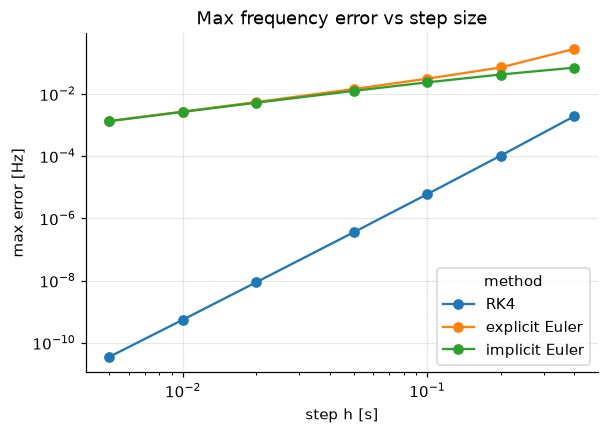</a><br><sub>02 · ODE solvers: error vs step size (convergence order)</sub></td><td width="50%"><a href="notebooks/03_load_profile_clustering_kmeans.ipynb">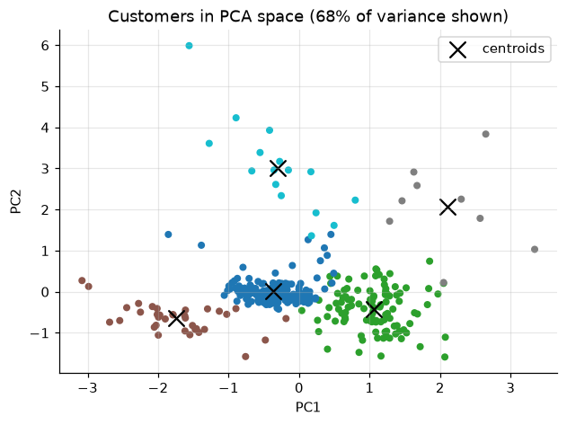</a><br><sub>03 · Customer types found by k-means (PCA view)</sub></td></tr>
<tr><td width="50%"><a href="notebooks/04_anomaly_detection_autoencoder.ipynb">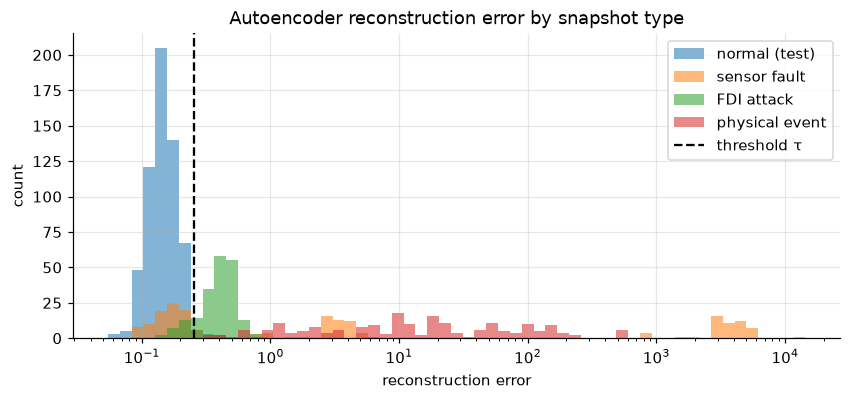</a><br><sub>04 · Autoencoder error separates faults and attacks</sub></td><td width="50%"><a href="notebooks/06_forecasting_ensembles_neural.ipynb">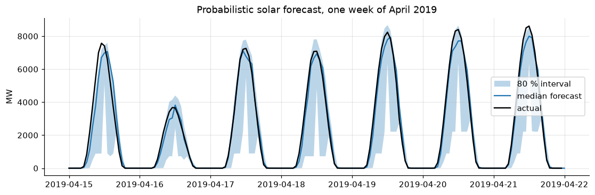</a><br><sub>06 · Probabilistic solar forecast (80 % interval)</sub></td></tr>
<tr><td width="50%"><a href="notebooks/07_dynamic_security_assessment.ipynb">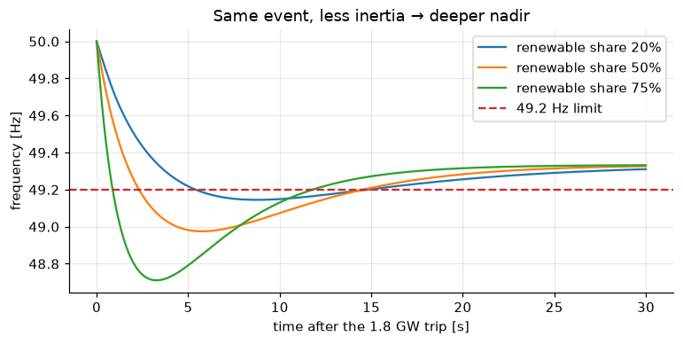</a><br><sub>07 · Less inertia → deeper frequency dip</sub></td><td width="50%"><a href="notebooks/08_cable_overload_prediction.ipynb">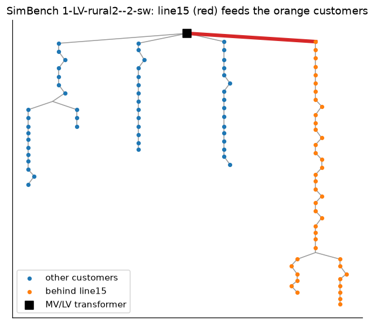</a><br><sub>08 · Capstone: the cable and the customers behind it</sub></td></tr>
<tr><td width="50%"><a href="notebooks/09_optimal_scheduling_milp.ipynb">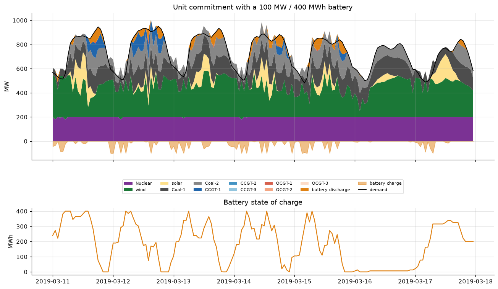</a><br><sub>09 · Unit commitment with a battery</sub></td><td width="50%"><a href="notebooks/10_surrogate_power_flow.ipynb">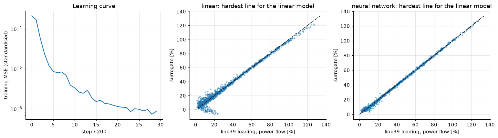</a><br><sub>10 · Linear vs neural surrogate on a two-way cable</sub></td></tr>
<tr><td width="50%"><a href="notebooks/11_mpc_home_energy.ipynb">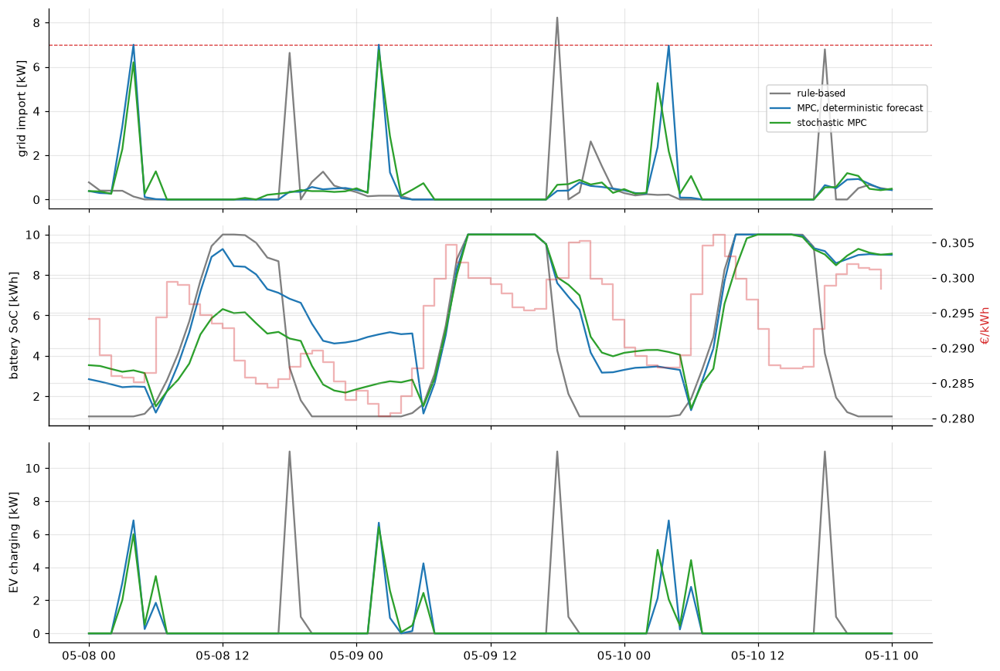</a><br><sub>11 · Rule vs MPC: grid import, battery, EV charging</sub></td><td width="50%"><a href="notebooks/13_physics_informed_power_flow.ipynb">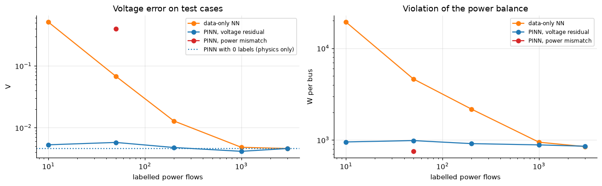</a><br><sub>13 · Physics-informed vs data-only network</sub></td></tr>
<tr><td width="50%"><a href="notebooks/14_cybersecurity_state_estimation.ipynb">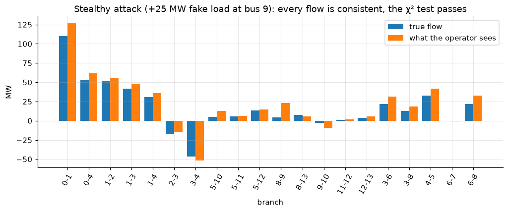</a><br><sub>14 · A stealthy attack the χ² test cannot see</sub></td><td width="50%"><a href="notebooks/15_congestion_management_flexibility.ipynb">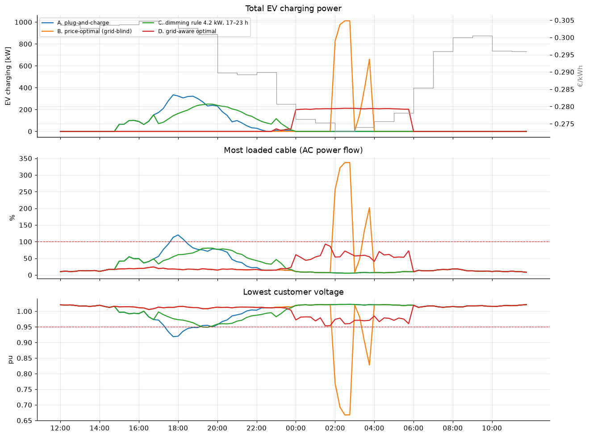</a><br><sub>15 · Four EV charging strategies checked by AC power flow</sub></td></tr>
<tr><td width="50%"><a href="notebooks/16_digital_twin_building.ipynb">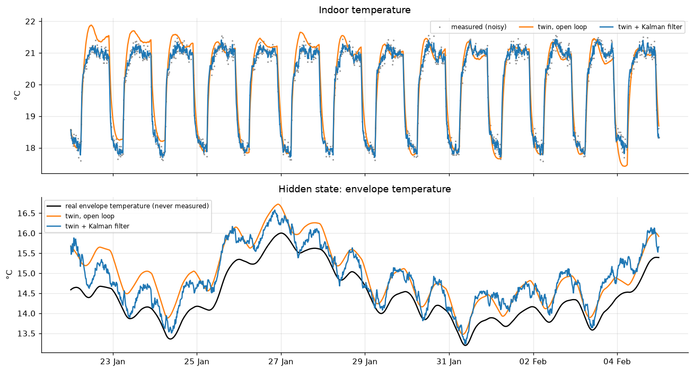</a><br><sub>16 · Digital twin + Kalman filter estimate a hidden temperature</sub></td><td width="50%"><a href="notebooks/17_integrated_energy_hub.ipynb">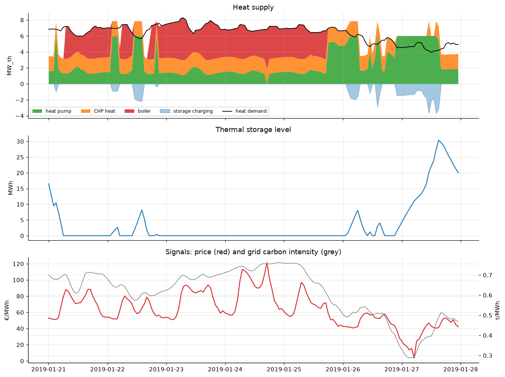</a><br><sub>17 · Energy hub: heat pump, CHP, boiler and heat storage</sub></td></tr>
</table>

## Quick start

```bash
git clone <this repository> energy_ai && cd energy_ai
uv venv --python 3.12 .venv            # or: python3.12 -m venv .venv
uv pip install --python .venv/bin/python -e ".[dev]"
.venv/bin/python -m ipykernel install --user --name energy-ai-gpu --display-name "Energy AI (Intel GPU)"
.venv/bin/jupyter lab notebooks/
```

**GPU.** `get_device()` picks CUDA, Intel XPU or the CPU automatically. Every notebook also runs on a CPU; only the
neural-network parts get faster on a GPU.
- NVIDIA: the default `torch` wheel includes CUDA.
- Intel integrated / Arc GPUs: `uv pip install --python .venv/bin/python torch --index-url https://download.pytorch.org/whl/xpu`.
  On some integrated GPUs `torch.randperm` fails on the device; the notebooks create permutations on the CPU and move them.

**Data** is downloaded on first use into `data/raw/` and cached in `data/processed/`. This is about 400 MB, mostly
the OPSD time series and the UCI customer data. The first run of the grid notebooks also simulates a few thousand
power flows (a few minutes); the results are cached.

**Rebuilding notebooks.** The notebooks are generated from plain-Python sources in `notebooks/py/` (jupytext
percent format, easy to diff and review):

```bash
.venv/bin/python tools/build_notebooks.py 08_cable_overload_prediction    # or --all
```

After a rebuild, `tools/export_figures.py` refreshes the PNGs in `results/figures/`.
`tools/sync_markdown.py <name>` copies text-only edits into an executed notebook without re-running it (it refuses
if any code cell changed).

## Repository layout

| Path | Content |
|---|---|
| `notebooks/` | executed notebooks, numbered from easy to advanced |
| `notebooks/py/` | their sources (percent-format Python) |
| `src/energy_ai/` | shared code: data loaders, power-flow snapshot generator, device selection, plot style |
| `tools/` | build and inspection scripts |
| `results/figures/` | every notebook figure as PNG (`tools/export_figures.py`) |
| `data/`, `models/` | created at run time (not versioned) |

## Data sources

All are open and downloaded automatically; please check each provider's licence before redistributing data.

- [Open Power System Data](https://data.open-power-system-data.org/time_series/): hourly load, wind, solar and day-ahead prices (Europe).
- [Open-Meteo historical weather API](https://open-meteo.com/en/docs/historical-weather-api): hourly weather.
- [UCI ElectricityLoadDiagrams 2011–2014](https://archive.ics.uci.edu/dataset/321/electricityloaddiagrams20112014): 370 Portuguese customers.
- [SimBench](https://simbench.de): German benchmark distribution grids with yearly 15-minute profiles (via the `simbench` package).
- IEEE 14-bus test system (via `pandapower.networks`).

## Next steps

Phase 2 is planned in [NEXT_STEPS.md](NEXT_STEPS.md): a **forecast-to-value engine** (probabilistic wind, solar and
price forecasts judged by the money they earn, benchmarked on the HEFTCom2024 competition data) and a **mini-grid AI
planner for Mali** (solar resource, demand estimation, cost-optimal sizing, LCOE and tariff gap, forecast-driven
dispatch). The plan is based on the IEA, IRENA and US DOE reviews of AI for energy, current benchmarks and open tools.

## Licence

Code: MIT (see `LICENSE`).
